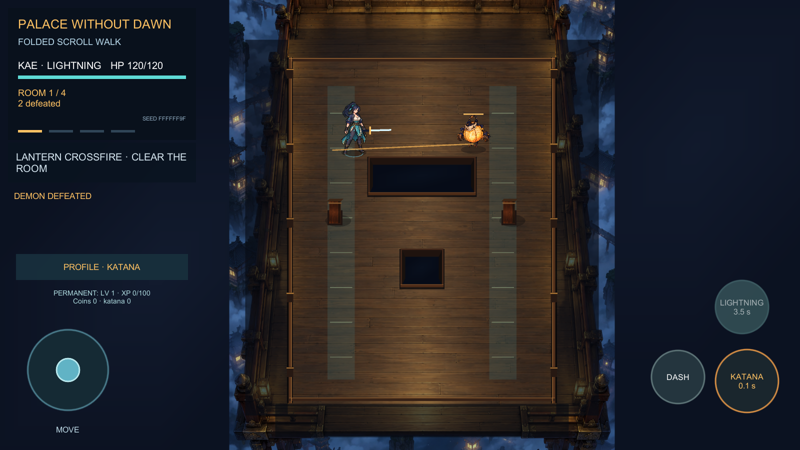
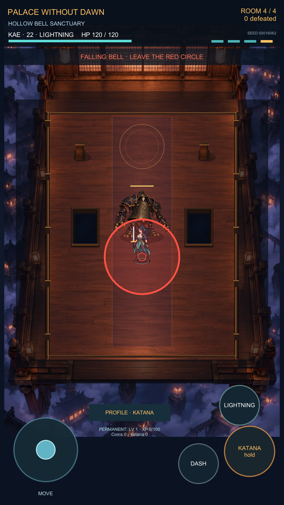
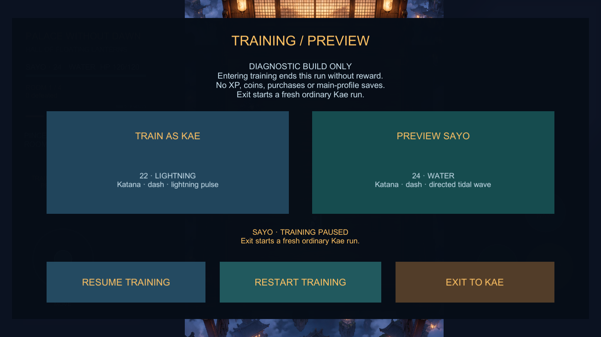
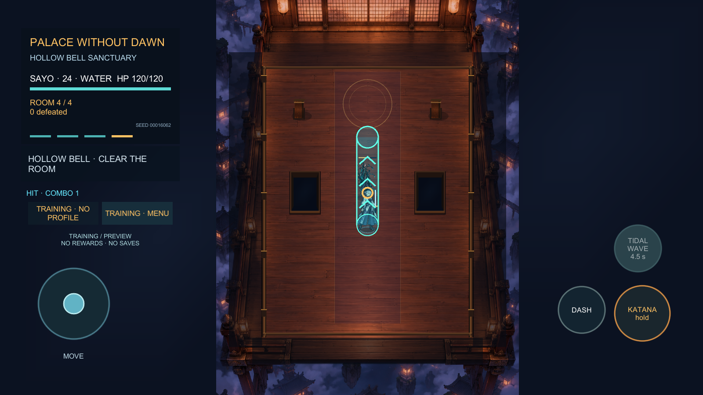

# Palace Without Dawn — 0.9.1 /build 6

Diagnostic patch for the original single-player action roguelite: separate identity/HP rows, adaptive safe-area HUD and corrected katana/skill touch rectangles. Includes an opt-in, non-interactive local input/lifecycle overlay in Training, default OFF, with bounded memory and no analytics/network/logfile. Training remains temporary Kae/Sayo preview with no rewards, unlocks or main-profile writes. Ordinary Kae and local progression stay separate. Source code remains private.

[Download 0.9.1](https://github.com/Limbo63/palace-without-dawn-releases/releases/download/v0.9.1-diagnostic.6/PalaceWithoutDawn-0.9.1-b6.ipa) · [Release notes](https://github.com/Limbo63/palace-without-dawn-releases/releases/tag/v0.9.1-diagnostic.6) · [AltStore source](https://raw.githubusercontent.com/Limbo63/palace-without-dawn-releases/main/altstore-source.json)

**Installation through AltStore, real touch/multitouch, OS lifecycle, iPhone performance, icons and runtime ABI remain unverified.** Fresh Unity/Xcode/package/static checks passed.121 Xcode warnings have the same seven categories as 0.9's 120: one additional generated translation unit emits the existing libc++ warning. IL2CPP target 11 versus final minOS 15 remains an explicit runtime risk; declared iOS 15 is not a compatibility guarantee. This is an unsigned/re-signable diagnostic candidate, not production or App Store readiness.

## Integrity and history

- PalaceWithoutDawn-0.9.1-b6.ipa: 28746452bytes.
- SHA256: `1b9545a48928d5433f6632d86631adbedbc0bf807eda59460c172552749d8339`.
- Existing bundle ID and stable source/save identity preserved.
- Previous [0.9](https://github.com/Limbo63/palace-without-dawn-releases/releases/tag/v0.9.0-diagnostic.5), [0.4](https://github.com/Limbo63/palace-without-dawn-releases/releases/tag/v0.4.0-prototype.4), [0.2.1](https://github.com/Limbo63/palace-without-dawn-releases/releases/tag/v0.2.1-prototype.3) and [0.1](https://github.com/Limbo63/palace-without-dawn-releases/releases/tag/v0.1.0-prototype.1) remain available unchanged.

## Retained Editor feature captures

These earlier actual Editor captures show included room/boss/Training/water features, not physical-device or 0.9.1 overlay validation. Boss/water frames use controlled fixtures. Older 0.4 images remain in assets/source.

This release-only repository excludes personal saves, credentials, provisioning, internal logs and checkout paths. No payment SDK, game account system or server is connected.
