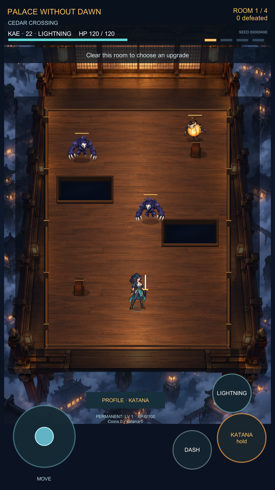
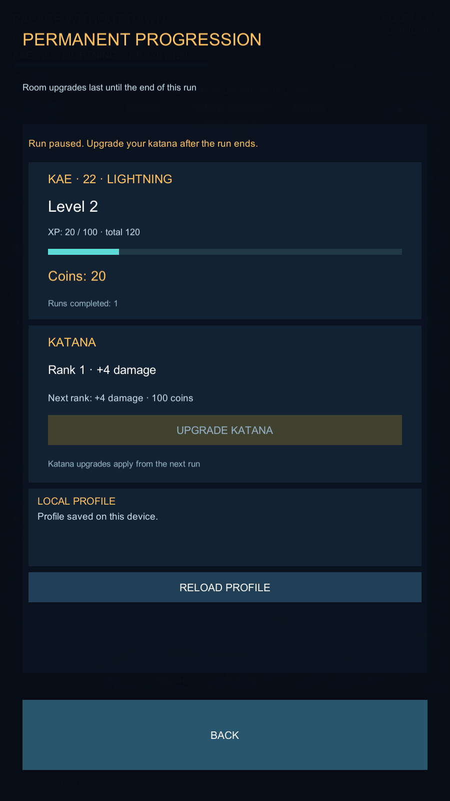

# Palace Without Dawn — 0.4.0 / build 4

A diagnostic prototype of an original single-player action roguelite in a changing Japanese magical castle. Direct katana combat, dash and lightning lead through four rooms with temporary upgrade choices and the Hollow Bell boss.

The current native build includes original prototype sprites with simple animation/hit feedback, an English HUD, Kae experience/levels, earned coins, permanent katana upgrades and versioned local saves. Source code remains private. This repository contains release artifacts and delivery metadata.

[Download 0.4.0](https://github.com/Limbo63/palace-without-dawn-releases/releases/download/v0.4.0-prototype.4/PalaceWithoutDawn-0.4.0-b4.ipa) · [Release notes](https://github.com/Limbo63/palace-without-dawn-releases/releases/tag/v0.4.0-prototype.4) · [AltStore source](https://raw.githubusercontent.com/Limbo63/palace-without-dawn-releases/main/altstore-source.json)

The IPA is unsigned/re-signable. **Physical iPhone/AltStore installation, real touch/multitouch and device performance remain unverified.** This is a diagnostic milestone, not production readiness.

## Verification

- Editor: 112 storage, 41 service, 51 progression Play Mode, 153 visual/layout and 66 combat checks passed. Save → Stop/Play → load, receipt idempotency and recovery used isolated profiles.
- Fresh Unity 6000.5.10f1 IL2CPP export: PASS, 0 errors/warnings. Fresh Xcode Release device build: BUILD SUCCEEDED.
- Final package: arm64 iOS device, English raw app names, stable bundle/version, content audit, ZIP CRC, size and SHA-256 passed.
- Previous 0.2 native/Data are not reused. Historical 0.2.1 remains a separate plist-only installation-name fix.

## Editor captures

These are actual game pixels from the 0.4 source and an isolated QA profile; they do not prove native device rendering or touch input.

## Identity and integrity

- Bundle ID: `com.limbo63.palacewithoutdawn`; source URL and save identity remain unchanged.
- Artifact: `PalaceWithoutDawn-0.4.0-b4.ipa`, 27177794 bytes.
- SHA-256: `3477d59c5b407b94c6519b80637ac75363a8432e0bfffd591689aee706967a7b`.
- Private source checkpoint: `2c148e37acb731f3d40e5115d3c83aba053e05e0`.
- Release tag: `v0.4.0-prototype.4`. Published 0.2.1 and 0.1.0 remain available.

Release files exclude personal saves, credentials, provisioning and internal logs. Published metadata omits local source-checkout paths. No payment SDK, game account system or game server is connected. Art and balance remain prototypes.
