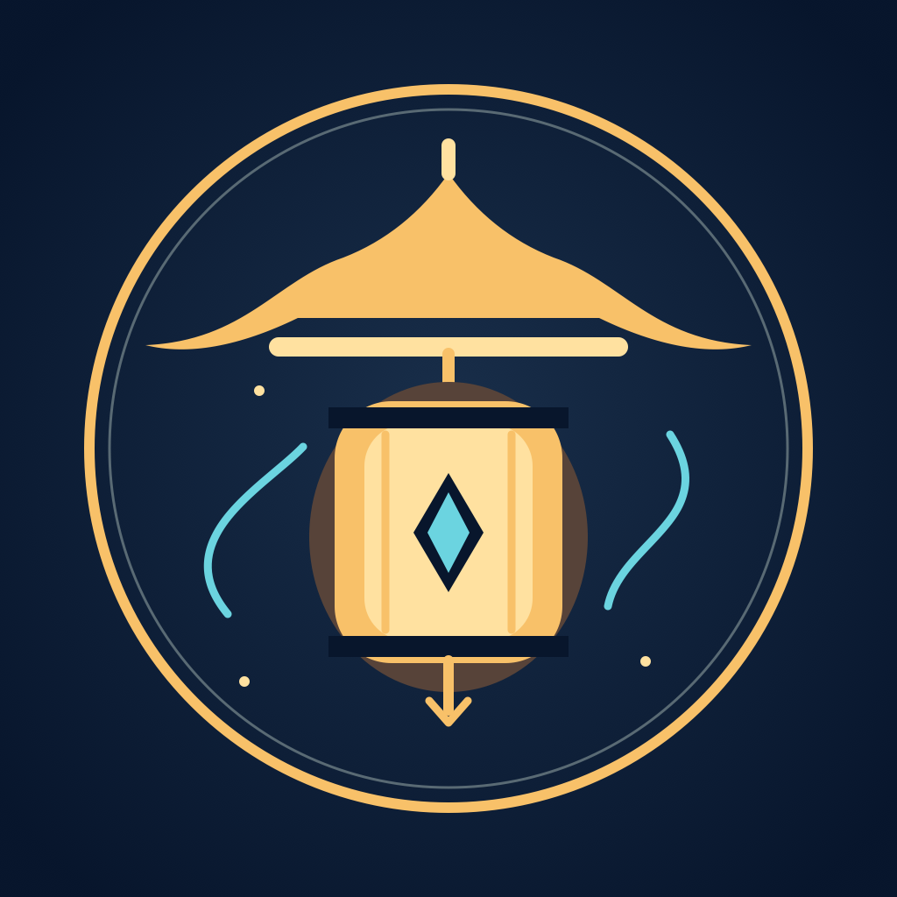

# Дворец без рассвета

Публичные контрольные сборки и отдельный источник AltStore Classic. Исходники приватные.

## Версия0.1.0, build1 — первый прототип

[Релиз и IPA](https://github.com/Limbo63/palace-without-dawn-releases/releases/tag/v0.1.0-prototype.1)

Источник для добавления в AltStore Classic:

```text
https://raw.githubusercontent.com/Limbo63/palace-without-dawn-releases/main/altstore-source.json
```

Каэ,22 года: катана, рывок и молния; японская арена, два вида демонов, босс с предупреждаемыми атаками, три волны, победа/поражение/restart. Визуал — временная оригинальная графика.

Проверено:26 адресных Unity Play Mode проверок и настоящий Stop/Play; самостоятельный импорт/компиляция чистого проекта; Unity iOS-export; Xcode arm64 device Release build; состав/identity/Mach-O/CRC IPA. SHA-256 и безопасный build manifest приложены к релизу.

Приложение в IPA не подписывалось и требует переподписи AltStore. Физический iPhone, установка AltStore, native icon и performance на устройстве не проверены. Xcode archive не запускался. Metadata minimumOS —15.0. Платежей, аккаунтов, серверов и сохранения нового прогресса нет.



## Версии

Каждый большой проверенный этап получает отдельный tag и новые версии/build numbers. Старые артефакты не заменяются. Source JSON использует точные version/build/size из проверенного IPA. Формат: [официальная документация AltStore](https://faq.altstore.io/developers/make-a-source).

Другие приложения и источники не изменяются. Здесь нет исходников игры, личных сейвов, секретов, provisioning и внутренних логов.
